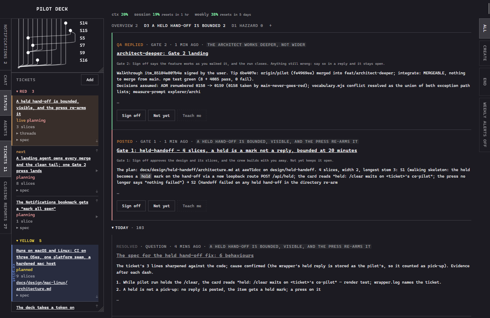
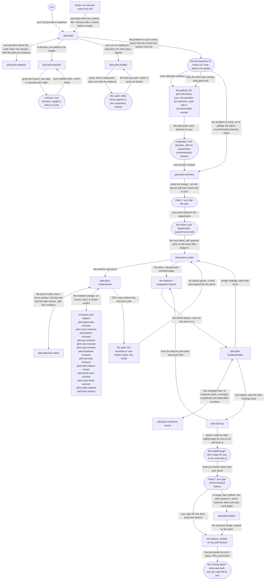

`this project is built for Claude Code users and is intentionally built to fit with a max plan (yummy token subsidization) - not to say that it is token inefficient, but that it was built around large workloads and isn't the best fit at smaller scales. Not a swarm level orchestrator, just long horizon coding tasks.`

# BETA 
### UI unpolished, CPU intensive at times, still much token usage optimization potential, but autonomous workflows are really good, probably another week of work till polished when my exams are done

# Pilot Deck Claude Code

Built on the principles and practices of agentic development pioneers [Matt Pocock](https://github.com/mattpocock) and [Affaan Mustafa](https://github.com/affaan-m), Pilot Deck is a crew of agents that carries any software feature, from cloud configuration to web app, from idea all the way to a reviewed pull request.

- Every question the agents have waits as a thread on one local webpage, the **deck**, and the reply you type there reaches them while the run keeps going.
- You are grilled only as deep as you choose, every question comes with a researched default, and **Teach me** walks you through any decision until it is yours.
- Plan hard, then walk away: you sign the plan at **Gate 1**, the crew builds while you are away, and you sign the finished feature at **Gate 2**.



Contents: [Install](#install) · [Use](#use) · [Features](#features) · [How it fits together](#how-it-fits-together) · [Principles](#principles) · [Your part](#your-part) · [Layout](#layout) · [Built on](#built-on) · [Licence](#licence)

## Install
`only dog-fed on windows 11, yet to try e2e on other OS · CI: windows, macos, ubuntu`

Open Claude Code anywhere and paste this in. Claude does the rest, and asks you
before it changes anything of yours:

```text
Install the pilot plugin on this machine and set it up for me.

Run these two, in this order:

    claude plugin marketplace add HazzardRust/pilot
    claude plugin install pilot@pilot

Then find the plugin's directory with `claude plugin list --json` (the entry
whose id is pilot@pilot), read docs/INSTALL.md inside it, and do exactly what it
says, in order: the dependency install, the global `pilot` command, the settings
merge, the rules copy, the CLAUDE.md excerpt and the verification at the end.

Ask me the three questions it tells you to ask, and wait for my answers.
Overwrite nothing I already have, and end with its table of what changed and
what you left alone.
```

The install is a prompt because a settings merge, a rules copy and a consent step are what an agent gets right and a
person gets wrong by hand (ADR 0002). [`docs/INSTALL.md`](docs/INSTALL.md) says exactly what is written where.

A second run changes nothing. To update, `claude plugin update pilot@pilot` is all there is.

On a Mac, macOS asks before a terminal reads `~/Desktop`, `~/Documents`, `~/Downloads` or iCloud Drive: keep
repositories elsewhere, or give your terminal Full Disk Access in System Settings > Privacy & Security.

## Use

In the repository you want to work on:

```bash
pilot run
```

That is the one command you type. Everything after it waits for you on the deck, at <http://127.0.0.1:4321>,
bound to the loopback interface only. Its state lives in `~/.claude/pilot/`, never in your repository, and it
refuses to store anything that looks like a key or a token.

A run has a day and a night. By day you plan with the pilot: the grilling, then Gate 1, while the ticket shows red.
By night, yellow, the crew builds for as long as it takes and needs nothing from you. It turns green once the feature is
built and QA brings it to you, and your Gate 2 press ends it.

Starting a run without the wrapper, the commands under the hood, where run branches live and slow gates on Windows: [`docs/OPERATING.md`](docs/OPERATING.md).

## Principles

In the order they matter, each with what delivers it today:

1. **Close the intent gap both ways, as fast or as exactly as you choose.** Your intent reaches the crew through the grilling,
   theirs reaches you through Teach me and QA's walkthrough, and the depth dial trades speed for accuracy.
2. **Make sure you understand.** The grilling puts each load-bearing decision to you even when the pilot knows the answer,
   and Gate 1 waits on your press; turn the depth down when you would rather it decided.
3. **Spend tokens and attention on purpose.** What repeats moves into deterministic scripts and refusals, a Haiku fact sheet
   reads before an Opus implementer does, models are picked per role, and every agent reports its friction.
4. **Keep a long memory.** Each run's record lives on the deck and mirrors into the repository, its decisions become ADRs,
   and friction rows survive every session.
5. **Optimise on its own.** Each closing report ranks the crew's friction into "make agents cheaper here", and
   the audit (`/pilot:audit`), offered every ten runs, measures what slows agents in your repository; you pick what lands.
6. **The system wayfinds on its own.** Nothing to memorise: once the idea is in, the deck's questions, the three lanes and the
   slice chain grill, architect, schedule, build, review and merge each slice into the feature's branch, and you just answer the questions.

Model and harness agnosticity is the intent for later; today Pilot is built on Claude Code and Claude models.

## Features

- **Day and night**: red planning and green concluding need you, yellow implementing does not, so a burst of planning feeds a long stretch away from the keyboard.
- **Chain of command**: the pilot keeps the big picture; the co-pilot, the role agents and their helpers each work a level of detail below it and report back up the chain.
- **Principles review**: once per feature an Opus fundamentalist argues against the finished design, subtraction first, judging modularity, minimalism, readability, maintainability and scalability by the literature (Parnas, Ousterhout, Beck, Fowler, Lehman), on measured coverage, mutation, complexity and duplication.
- **Three lanes**: a planning, an implementing and a concluding ticket run at once, so the next feature is planned while this one is built.
- **Walkthroughs**: Where ever a user only step is needed - reviewing user facing features, configuring cloud environments, permission blocked steps - the pilot presents a step by step walkthrough on how to do it.
- **Co-pilot**: builds a signed ticket in the background, slice by slice, while the pilot plans the next.
- **Tickets in colour**: work queues on the deck's rail as tickets, red while planned, yellow while built, green while concluded, each with its slice count and its open questions.
- **Vertical Slices**: tickets broken down into vertical slices rather than layer by layer, allowing for faster and more isolated verification loops.
- **Slice graph**: each run draws its slices as a git graph whose dots fill as a slice goes from planned to in progress to integrated.
- **Yours column**: the status table names your next action on each slice, and every tab counts the threads waiting behind it.
- **Usage at a glance**: the deck's header and Claude Code's status line show how full the context is and how much of the five-hour and weekly limits is gone.
- **Audit, offered on its own**: on a repository's first run and every ten runs after, the pilot asks whether to audit it for what slows agents; on yes it runs in the background.
- **Permission refusal**: a crew permission prompt never stalls a run; it is refused and posted to the deck as a blocked item.
- **Hand-off and recovery**: a context hands off at specific token caps (e.g. 230k tokens) to a fresh session rather than compact, and a crashed run recovers from its record.
- **Observability**: CLI remains open on the terminal to inspect agents at the lower level whilst they work,
- **Fact sheet**: before an implementer reads the code, a Haiku helper lists every symbol, call site and test its slice names.
- **Landing from the deck**: a finished feature lands on the pilot branch before QA, and your Gate 2 Sign off merges the last fixes and readies its PR.
- **Closing report**: every run ends with its slices, its PRs and the crew's friction ranked into "make agents cheaper here".
- **Mechanisms over habits**: a move agents keep re-deriving becomes a script, a record or a refusal.
- **Budgets**: the agents are capped per lane, and each role and slice gets the model its job needs.
- **Run record and ADRs**: a run's state lives on the deck and mirrors into the repository; its decisions become ADRs.

## How it fits together

The graph is the same on any repository and any stack, from cloud configuration to a web app:
the same agents pass the work along the same machinery, and the same deck
is where everything that needs you waits. Only the gate's commands and the reviewer's language change.

The crew is a chain of command. The pilot holds the big picture; a level down the co-pilot directs one ticket and
each role agent owns one step; below them a helper answers one question. Each reports to the agent that spawned
it, so most news reaches the pilot as a conclusion, never as a file dump.

An average run, then the same steps drawn:

1. You give `pilot run` your idea, and `pilot:pilot` asks first how deep to be grilled.
2. **The grilling** puts each decision to you on the deck, with a researched recommended answer.
3. `pilot:pilot-architect` cuts the design into slices that each work end to end.
4. You press **Gate 1** on the plan, and its ticket queues to be built.
5. `pilot:pilot-co-pilot` builds that ticket in the background while the pilot plans the next.
6. `pilot:pilot-implementer` builds each slice tests first through the gate and one reviewer; the co-pilot merges it into the feature's branch.
7. `pilot:pilot-fundamentalist` argues against the whole feature once, subtraction first, by principles from the literature; the kept findings are fixed and the feature lands on the pilot branch.
8. `pilot:pilot-qa` runs the feature where it is meant to run and hands you a walkthrough to work.
9. You press **Gate 2**: the deck lands the feature on the pilot branch, QA's fixes with it.



## Your part

Three steps stay yours through a run, in order:

- **Spec design** — you sign off the architecture artefact at Gate 1, before a slice is built.
- **Quality assurance** — you work the QA agent's walkthrough of the feature where it is meant to run, at Gate 2, before the feature PR lands on the pilot branch.
- **Code review** — mostly AI: a language reviewer per slice, then one principles pass per feature. The plugin stops short of merging the feature PR; to have it merge its own PRs, say so as a standing rule in your own `CLAUDE.md`.

## Layout

Start here: [`docs/architecture.md`](docs/architecture.md) for how the directories connect, then [`deck/README.md`](deck/README.md) for the order to read the deck in.

| Path | What it is |
| --- | --- |
| `.claude-plugin/` | the plugin manifest and this repository's marketplace entry |
| `agents/` | the pilot and its crew, the auditor `/pilot:audit` runs, and the fifteen reviewers and helpers they call |
| `bin/` | the `pilot` command and its launcher |
| `deck/` | the deck: MCP server, HTTP server, JSON store, page; [`deck/README.md`](deck/README.md) maps its modules |
| `hooks/` | the Claude Code hooks the plugin registers |
| `rules/` | the rules the install copies into `~/.claude/rules/` |
| `skills/` | the methodology the crew loads |
| `vendor/` | the fragments `VENDOR.md` is assembled from |
| `scripts/` | the install's own steps, and the checks that keep the vendoring honest |
| `fixtures/` | repositories-to-be with planted friction, which QA copies out and audits; never collected by `npm test` |
| [`docs/adr/`](docs/adr/README.md) | the architecture decision records; its index is the first read |
| `docs/INSTALL.md` | what Claude follows when you paste the prompt above |
| `docs/design/` | the architecture artefact each feature is built from, one directory per feature |

## Built on

Pilot is by HazzardRust (MIT, as [`LICENSE`](LICENSE) says). Some of it was copied
from two MIT-licensed projects rather than depended on:

- the methodology skills from [Matt Pocock's skills](https://github.com/mattpocock/mattpocock-skills) (Copyright (c) 2026 Matt Pocock);
- the reviewer agents, six skills and the whole rules tree from [ECC](https://github.com/affaan-m/ECC) by Affaan Mustafa (Copyright (c) 2026 Affaan Mustafa).

Both notices travel whole in [`THIRD-PARTY-NOTICES.md`](THIRD-PARTY-NOTICES.md). [`VENDOR.md`](VENDOR.md) is the
ledger of what was taken and changed, and why; every copied file carries a provenance header, and
`node scripts/check-upstream.mjs` reports which have drifted from the upstream on your machine.

One dependency is fetched rather than vendored: `chrome-devtools-mcp@1.9.0` (Apache-2.0), pinned, which the
implementer and the QA agent use to drive a browser.

## Licence

MIT — see [LICENSE](LICENSE).
